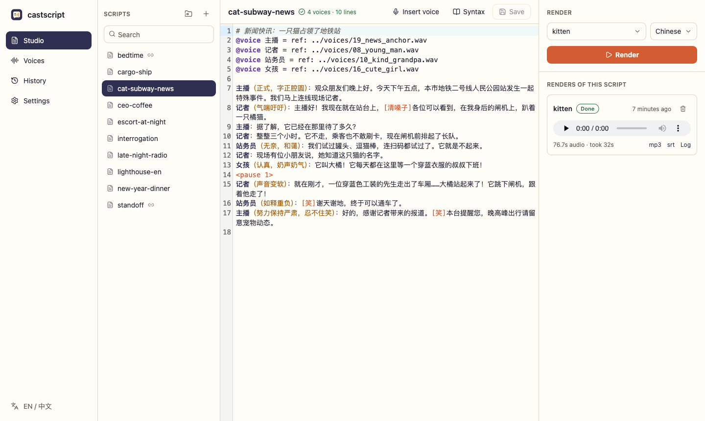
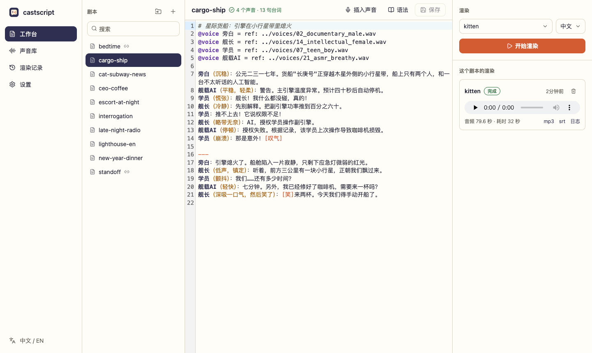
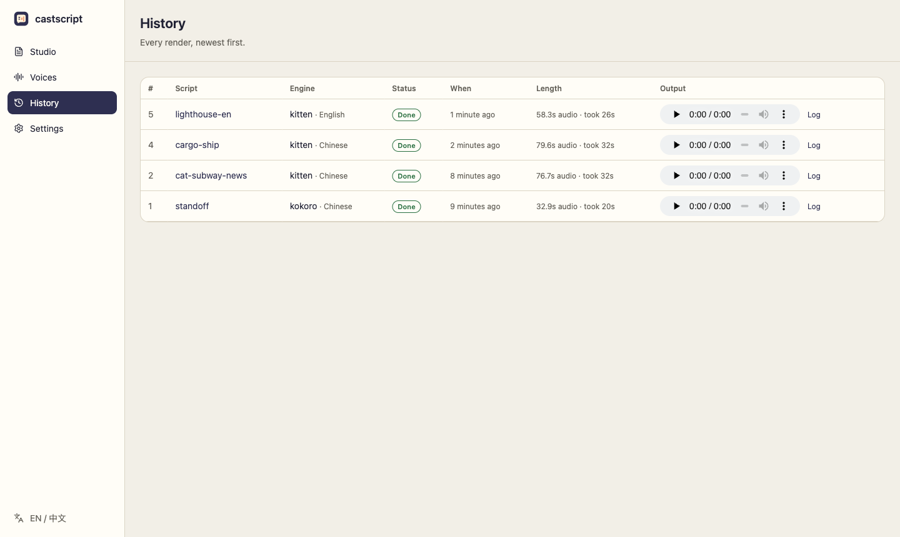

# castscript

A plain-text format for multi-voice audiobooks and radio plays, plus a renderer that turns it into MP3 and SRT with a local TTS engine.

- **Write like a script.** One `角色（情绪）：台词` line per utterance; no markup to learn.
- **Per-character voices.** Clone from a reference WAV, design from a text description, or pick an engine preset.
- **Emotion, vocal events, pauses.** `（低声，疲惫）`, `[叹气]`, blank-line / `---` / `<pause N>` timing, and `<at 1:05>` start times so subtitles line up with video.
- **Engine-independent, fully local.** The same script renders on any of eleven local TTS engines; outputs MP3 and SRT subtitles.
- **Web app and menu bar app.** Edit, render, and play scripts in a local web app in English or Chinese, opened from the command line or a macOS menu bar icon.

```
@voice 旁白 = ref: voices/narrator.wav
@voice 林风 = ref: voices/hero.wav

旁白：那天夜里，雨下得很大。
林风（低声，疲惫）：掌柜的，还有空房吗？[叹气]
```

Hear what it sounds like: [the rainy-night scene rendered by VoxCPM2](https://github.com/jazelly/castscript/blob/main/examples/chinese/voxcpm/rain-night.mp3), or browse [every engine's renders](https://github.com/jazelly/castscript/tree/main/examples).

Write, render, and listen in the [web app](#web-app) or from the command line:



The format is engine-independent. See [SPEC.md](https://github.com/jazelly/castscript/blob/main/SPEC.md) for the full format and what each engine supports.

## Engines

castscript runs inside the engine's own Python environment, so engines with conflicting dependencies never share one. Give each engine its own virtual environment and install `castscript` plus what the table lists, for example `pip install castscript qwen-tts`.

| `--engine` | Engine | Install |
|---|---|---|
| `breeze` | Breeze TTS 2 | a [breeze-tts-mlx](https://github.com/rishikksh20/breeze-tts-mlx) checkout |
| `qwen` | Qwen3-TTS 1.7B | `qwen-tts` |
| `chatterbox` | Chatterbox Multilingual V3 | `"chatterbox-tts @ git+https://github.com/resemble-ai/chatterbox.git"` |
| `omnivoice` | OmniVoice | `omnivoice` |
| `kitten` | KittenTTS 2 | `"kittenml[mlx]"` on a Mac, `kittenml` elsewhere |
| `kokoro` | Kokoro-82M | `"kokoro>=0.9.4" "misaki[zh]"` |
| `pocket` | Pocket TTS | `pocket-tts` |
| `voxcpm` | VoxCPM2 | `voxcpm` |
| `indextts` | IndexTTS-2.5 | an [index-tts](https://github.com/index-tts/index-tts) checkout, set up with `uv sync` and `hf download IndexTeam/IndexTTS-2.5 --local-dir=checkpoints` |
| `audio8` | Audio8-TTS Realistic 0.6B | `torch torchaudio "transformers>=4.57,<5" librosa` |
| `dots` | dots.tts | `dots.tts` (see below) |

The renderer needs `ffmpeg` on `PATH` (`brew install ffmpeg`, or `winget install ffmpeg` on Windows). Models download from Hugging Face on first use.

### Platforms

macOS on Apple Silicon is the primary platform: every ✅ in its column rendered a multi-voice script on an M3 Ultra, using the backend shown. On Windows, engines use an NVIDIA GPU through CUDA when PyTorch has it, and the CPU otherwise; that column follows what each engine supports upstream and has not been tested.

| `--engine` | macOS (Apple Silicon) | Windows |
|---|---|---|
| `breeze` | ✅ MLX | ❌ MLX is Apple-only |
| `qwen` | ✅ MPS | ✅ CUDA / CPU |
| `chatterbox` | ✅ MPS | ✅ CUDA / CPU |
| `omnivoice` | ✅ MPS | ✅ CUDA / CPU |
| `kitten` | ✅ MLX | ✅ ONNX |
| `kokoro` | ✅ CPU | ✅ CUDA / CPU |
| `pocket` | ✅ CPU | ✅ CPU |
| `voxcpm` | ✅ MPS | ✅ CUDA / CPU |
| `indextts` | ✅ MPS | ✅ CUDA / CPU |
| `audio8` | ✅ MPS | ✅ CUDA / CPU |
| `dots` | ❌ runs, but single-threaded CPU is too slow to use | ✅ CUDA; install `pynini` from conda-forge |

## Usage

1. Put reference voices next to your script. Each `voice.wav` needs a `voice.txt` that contains its exact transcript.
2. Render with the `castscript` command from the engine's environment:

```bash
castscript rain-night.cast.txt --engine chatterbox
```

On Windows, set `PYTHONUTF8=1` first:

```bat
set PYTHONUTF8=1
castscript rain-night.cast.txt --engine chatterbox
```

This writes `.wav`, `.mp3` (loudness-normalized), and `.srt` next to the script. `--out PATH` picks another location, without an extension.

`--split DIR` instead writes each line to its own WAV in `DIR`, numbered in script order (`0001.wav`, `0002.wav`, ...) without pauses, for games and apps that play lines one at a time. A line left empty after dropping unsupported vocal events gets no file.

`--language` (default `zh`) sets the language for the engines that need one: Qwen3-TTS, Chatterbox, OmniVoice, KittenTTS, Kokoro, Pocket TTS, IndexTTS, and dots.tts.

## Web app

`castscript web` opens the castscript web app at `http://127.0.0.1:47810/`, in English or Chinese:

- **Studio**: the script list, an editor with castscript highlighting that marks the line of a parse error, and a render panel that lists only the engines able to voice the script, with progress, playback, subtitles, and logs.
- **Voices**: the reference voice library, with playback, upload, and import.
- **History**: every render, kept across restarts.
- **Settings**: the engines folder, Breeze paths, and the default render language.





Install `castscript` once as a global command (for example `uv tool install castscript`), run `castscript web`, and set **Settings → Engines folder** to a folder holding one virtual environment per engine, named after the engine (`kokoro/`, `voxcpm/`, ...; IndexTTS as its `index-tts/` checkout). Each render runs inside that engine's own environment, exactly as the CLI does.

Everything lives in the workspace, `~/castscript` by default (`--workdir` picks another):

```
~/castscript/
  scripts/NAME.cast.txt   scripts
  voices/NAME.wav + .txt  reference voices
  renders/ID/             one folder per render: MP3, SRT, WAV
  castscript.db           SQLite: settings and render history
```

**Import** takes a folder or file path and links every `.cast.txt` script and every WAV with a matching `.txt` transcript into the workspace as symlinks, so the files stay where they are and edits reach the originals. `--port` picks another port; the server listens on 127.0.0.1 only.

The app's source is in [web/](https://github.com/jazelly/castscript/tree/main/web) (Vite, React, TypeScript, Tailwind, Radix, Lucide). `pnpm install && pnpm build` there writes it into `castscript/webui/`, which the Python package serves; build it before `uv build`. `pnpm dev` serves it on port 5174 against a running `castscript web`.

### macOS menu bar app

`castscript app` builds `~/Applications/castscript.app` and opens it. It runs `castscript web` in the background and puts a castscript icon in the menu bar whose menu opens the web app. It needs `swiftc` (`xcode-select --install`). The server log is at `~/Library/Logs/castscript-web.log`.

## Examples

[examples/](https://github.com/jazelly/castscript/tree/main/examples) has three short scenes rendered by every engine in Chinese and in English: the input scripts, the MP3s, and the SRTs, so you can hear each engine before installing it.

## Engine notes

**Breeze TTS 2:**

```bash
uv run --project ../breeze-tts-mlx --with castscript castscript rain-night.cast.txt \
  --breeze-dir ../breeze-tts-mlx --breeze-checkpoint ../breeze-tts-mlx/chkpt-mlx-int8
```

**Qwen3-TTS** loads one model per voice kind: Base for `ref`, CustomVoice for `preset`, and VoiceDesign for `design`.

**IndexTTS-2.5** needs `--index-dir` pointing at the checkout, and runs with that checkout's `.venv`:

```bash
uv pip install -p ../index-tts/.venv castscript
../index-tts/.venv/bin/castscript rain-night.cast.txt --engine indextts --index-dir ../index-tts
```

**OmniVoice** `design` voices take only its attribute vocabulary, such as `男，老年，低音调` or `female, low pitch, british accent`.

**KittenTTS 2** emotions are a fixed list of English words; see [SPEC.md](https://github.com/jazelly/castscript/blob/main/SPEC.md).

**Kokoro** has preset voices only. Chinese presets start with `zf_` or `zm_`. English needs spaCy's `en_core_web_sm` model installed in the environment. Languages other than English and Chinese need [espeak-ng](https://github.com/espeak-ng/espeak-ng).

**Pocket TTS** supports English, French, German, Portuguese, Italian, Spanish, and Dutch, not Chinese. Its built-in presets work as is. Cloning a `ref` voice needs the gated model: accept its terms at [huggingface.co/kyutai/pocket-tts](https://huggingface.co/kyutai/pocket-tts) and log in with `hf auth login`.

**dots.tts** depends on `pynini`, which has no macOS or Windows wheel on PyPI; on Windows, install it with `conda install -c conda-forge pynini`. On a Mac, run `brew install openfst`, then install with `CPATH=/opt/homebrew/include LIBRARY_PATH=/opt/homebrew/lib`. Pin the versions from upstream's `constraints/recommended.txt` (`torch==2.8.0 torchaudio==2.8.0 transformers==4.57.0`). Without CUDA it runs single-threaded on the CPU.

## Licenses

castscript is MIT-licensed. TTS engines and model weights carry their own licenses; check each before commercial use. In particular, Breeze TTS 2 weights and their outputs are for research and non-commercial use only, and IndexTTS weights are under the bilibili Model Use License Agreement.
